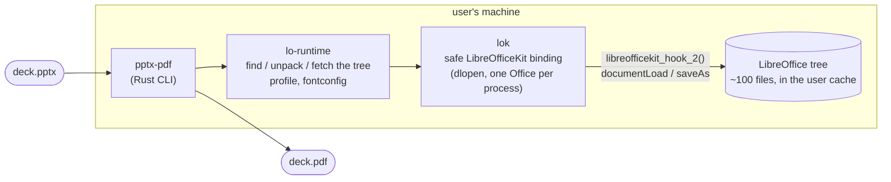
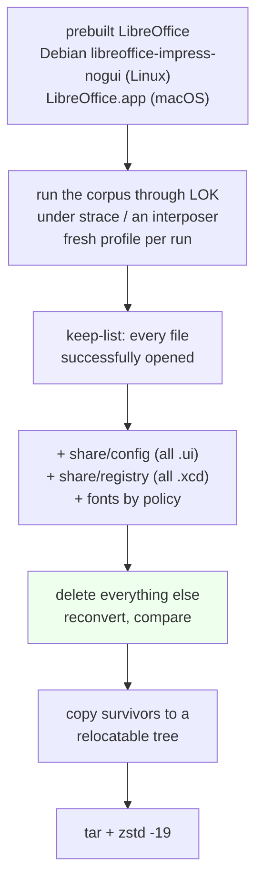
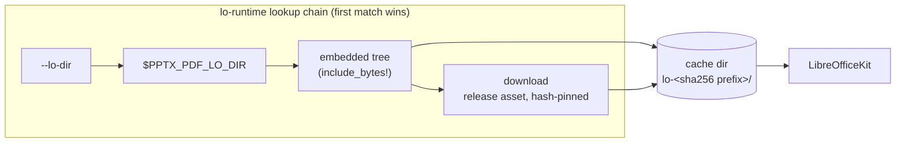

# Shipping LibreOffice's renderer in a 4 MB binary: how pptx-pdf converts PowerPoint to PDF

*September 2026*

`pptx-pdf` turns a `.pptx` into a PDF from the command line. The renderer inside it is
LibreOffice's, the same code that produces the PDF when you press *Export* in Impress, but
nobody who uses the tool installs LibreOffice. This post explains why we built it that way,
how the pieces fit, what it costs in bytes and seconds, and why it is legally fine.

---

## 1. Why

### Rendering PowerPoint well is hard

A `.pptx` is not a page description; it is a tree of shapes, placeholders, theme references,
master inheritance, text auto-fit rules, charts with their own XML dialect, SmartArt, embedded
fonts and a dozen other things whose *appearance* is only defined by what PowerPoint does with
them. Producing a PDF that looks like the deck means reimplementing that behaviour.

Two renderers have done that work to a standard people accept: PowerPoint itself, and
LibreOffice Impress. Everything else (HTML converters, "pure" libraries, cloud APIs that
secretly run one of the two) either renders a subset or is one of them in disguise. For a
tool that has to run on a server, in CI, or inside an agent's sandbox, LibreOffice is the only
option that is open source and headless.

### The usual way to use it does not fit those environments

The standard recipe is `apt-get install libreoffice` (or a 800 MB `.dmg`) and then
`soffice --headless --convert-to pdf`. That recipe is fine on a workstation and a bad fit
everywhere else:

- **Size.** `apt install libreoffice` on Debian trixie pulls 708 packages, 561 MB of
  download and **2.2 GB** installed (Java, fonts, every module); even the leanest choice,
  `libreoffice-impress-nogui` without recommends, is 151 packages and 366 MB on disk. The
  macOS disk image is 299 MB and unpacks to 805 MB. In a container image that is most of the
  image; in a CI job it is minutes of cache traffic per run; on an agent's machine it is an
  installation step the agent has to be allowed to perform.
- **Startup.** Every `soffice` invocation boots the whole suite before converting anything:
  about 0.3 s on Debian's lean `-nogui` build, 0.6-0.9 s for the macOS app, more for the
  stock desktop packages. It also needs a user profile directory with a lock file, so
  concurrent conversions need per-process profiles or they hang.
- **A moving target.** Package managers give you whatever version they have; the Homebrew
  cask on a CI runner pointed at a LibreOffice build that TDF had already removed from its
  download server. Reproducible output needs a pinned renderer.
- **Silent font substitution.** Headless LibreOffice resolves fonts through fontconfig on
  every platform, macOS included, and with no configuration it sees only the fonts it bundles.
  `soffice --headless` on a Mac converts a deck set in Lato into Linux Libertine without a
  word of warning. (Section 3 has the measurement.)

What we wanted was the renderer without the installation: one file, pinned, fast to start,
fonts done right.

### What we did not do

- **Compile LibreOffice.** A static, trimmed LibreOffice build is possible; the iOS and WASM
  ports do it. It costs hours per platform, tens of gigabytes of disk and a build machine
  with 64 GB of RAM for the link. That is a project, not a build step.
- **Rewrite the renderer.** Pure-Rust "office" crates exist. Their own status pages say they
  are not at parity, and for PPTX the gap is exactly the hard part: themes, placeholder
  inheritance, charts, SmartArt.
- **Wrap `soffice` in a subprocess.** Robust, but it inherits every problem above.

---

## 2. How

The idea in one sentence: **take a prebuilt LibreOffice, keep only the files a PPTX-to-PDF
conversion actually opens, and load those in-process through LibreOfficeKit.**

### Step 1: LibreOfficeKit instead of `soffice`

LibreOffice exposes a small, ABI-stable C API called
[LibreOfficeKit](https://docs.libreoffice.org/libreofficekit.html) (LOK): `dlopen` one library,
call `libreofficekit_hook_2(install_path, profile_url)`, then `documentLoad(url)` and
`saveAs(url, "pdf", filter_options)`. It is what Collabora Online and the Android/iOS apps use.
No subprocess, no IPC, no start centre: the conversion runs inside our process.

The `lok` crate wraps it in ~400 lines of Rust. The struct layouts are transcribed from
`LibreOfficeKit.h` and pinned by a test on their byte offsets; the library is loaded with
`libloading`; two constraints from LOK's own header are turned into types: one `Office` per
process ever (a process-wide flag) and single-threaded use (`!Send`). PDF options such as
`--pages` and `--notes` become the JSON `FilterData` string LOK expects
(`{"PageRange":{"type":"string","value":"2-5"}}`).

### Step 2: Find out which files a conversion needs

A LibreOffice install has ~2,100 files. We wanted the ~100 that matter, and we wanted the
list to be *measured*, not guessed. So we trace:

- **Linux**: `strace -f -e openat` around a 40-line C harness that does load→save through
  LOK. Every successfully opened file, plus each path's symlink-resolved and lexically
  normalised spellings (Debian links `registry/main.xcd` into `/etc`), goes on the keep-list.
- **macOS**: no `strace`, `fs_usage` needs root and `dtrace` is blocked by SIP. We use a
  `DYLD_INSERT_LIBRARIES` interposer that logs `open`/`opendir`/`dlopen` in-process, and
  merge in `DYLD_PRINT_LIBRARIES` output, because dyld maps dependent dylibs with its own
  syscalls that a libc interposer never sees.

Then everything not on the list is deleted from the install, the corpus is converted again
from what is left, and the outputs are compared to the originals: page counts, extracted text,
and on Linux a pixel diff of every rendered page. The strip is accepted only if nothing changed.

### Step 3: The things a trace does not show you

Three lessons, each learned from a failure:

**Deferred work.** After a document loads, LibreOffice's main-loop thread constructs the
document frame as a *deferred* event: `scrollbars.ui`, `infobar.ui`, and, if the input file
is read-only, `extrabutton.ui` for the "read-only" infobar. A harness that loads, saves and
exits never triggers it, so those files were never traced, got stripped, and the CLI died
with LibreOffice's "Unspecified Application Error"... only sometimes, only when the process
lived long enough. The traced and verifying runs now *settle* for a few seconds after load and
after save, include a read-only input, and every tree must pass a "sleep five seconds after
load" check before it ships.

**Conditional UI.** Infobars and dialogs are loaded lazily under conditions no corpus can
enumerate, and a missing `.ui` aborts the process. So `share/config/soffice.cfg` (every `.ui`)
and `share/registry` are kept wholesale. It costs 0.4 MB compressed.

**Fonts are not traced, they are chosen.** fontconfig opens every bundled font while building
its cache, so a trace keeps all of them. Instead the tree carries a policy set: the
metric-compatible substitutes (Liberation for Arial/Times/Courier, Carlito for Calibri,
Caladea for Cambria), DejaVu, OpenSymbol for bullets, and Linux Libertine because that is
what LibreOffice itself falls back to when a family is missing, so a deck with a missing font
renders *exactly* as it would with the full install.

### Step 4: Make the tree relocatable

Debian's `fundamentalrc` hardcodes `BRAND_BASE_DIR=file:///usr/lib/libreoffice`; we rewrite it
to `${ORIGIN}/..`, the form TDF's own tarballs use. For a portable Linux variant the ~90 MB of
system libraries the conversion maps (ICU data alone is 31 MB) are copied alongside and every
library gets an `$ORIGIN`-relative RUNPATH via `patchelf`, so nothing outside the tree is
needed except glibc. The macOS bundle is already `${ORIGIN}`-relative; its only trap was
`tar` on macOS adding AppleDouble `._*` files that configmgr then tried to parse as `.xcd`.

### Step 5: Ship it two ways

- **Self-contained**: the `tar.zst` is compiled into the binary with `include_bytes!` and
  unpacked into the user cache on first run. One file, works offline.
- **Slim**: a ~4 MB binary that downloads the same `tar.zst` from the GitHub release *of its
  own version* on first run. The tarball's SHA-256 is pinned into the binary at build time;
  a `cargo install --git`, which has no pin, verifies against the release's
  `SHA256SUMS` instead and remembers the resolved hash so later runs are offline.

Both key the cache directory by the tarball's hash, so an embedded and a slim binary built
from the same tree share one unpacked copy, and a new release never collides with an old one.
Unpacking goes into a staging directory renamed into place only when complete, so two
concurrent first runs cannot race each other into a half tree.

### Step 6: Fonts, profiles, and the per-run details

- `lo-runtime` writes a `fonts.conf` per run listing LibreOffice's own fonts, the platform's
  system font directories, any `--font-dir`, and a cache directory, unless the tree ships an
  `etc/fonts` (the Linux trees do) or the user has set `FONTCONFIG_FILE`. This is what makes
  headless LibreOffice see the fonts a user has installed.
- Each run gets a fresh user profile in the temp directory, removed on exit, so concurrent
  conversions never share LibreOffice's lock file.
- The release pipeline (`tools/lo-tree`, `.github/workflows/release.yml`) rebuilds the trees
  from the pinned upstream artefacts and runs every end-to-end suite before anything is published, including the embedded
  binary in a bare `debian:trixie-slim` and, on macOS, under `sandbox-exec` with
  `/Applications/LibreOffice.app` made unreadable.

---

## 3. Results

All numbers measured on the release pipeline or on an Apple M-series laptop; Linux x86_64 was
verified under emulation, so its timings are omitted rather than reported wrong.

### Size

Installing LibreOffice normally, measured from a bare Debian trixie image with every
dependency apt pulls in, and from the official macOS disk image:

| | packages | download | installed |
|---|---|---|---|
| `apt install libreoffice` as usually typed (recommends on) | 708 | 561 MB | **2,170 MB** |
| `apt install --no-install-recommends libreoffice` | 209 | 151 MB | 564 MB |
| `apt install --no-install-recommends libreoffice-impress` | 170 | 117 MB | 422 MB |
| `apt install --no-install-recommends libreoffice-impress-nogui` | 151 | 105 MB | 366 MB |
| macOS `LibreOffice.app` | | 299 MB | 805 MB |

And `pptx-pdf`:

| | Linux arm64 | Linux x86_64 | macOS arm64 |
|---|---|---|---|
| upstream source of the tree | Debian `-nogui`, 366 MB with deps | same | `LibreOffice.app`, 805 MB |
| stripped tree, packed (`zstd -19`) | 32 MB / 65 MB portable | 34 MB / 67 MB portable | 82 MB |
| self-contained binary (download) | 62 MB | 64 MB | 80 MB |
| slim binary (download) | 4 MB | 4 MB | 4 MB |
| cache after first run | 225 MB | 230 MB | 360 MB |

The Linux tree keeps ~100 of 2,120 files. macOS is larger because the only prebuilt macOS
LibreOffice is the full GUI build: `libmergedlo.dylib` alone is 137 MB and links the Skia
renderer and every import filter.

### Install and first run

Measured on a residential connection (80 MB self-contained macOS binary):

| step | time |
|---|---|
| `curl … install.sh \| sh` (download, verify SHA-256, extract) | 44 s |
| slim install (4 MB) | 3 s |
| first run, self-contained (unpack the tree, first LibreOffice boot, convert) | 18 s (macOS), 1.8 s (Linux arm64) |
| first run, slim (download 79 MB from GitHub, unpack, first boot, convert) | 63 s (macOS, same connection) |
| `cargo binstall --git` | 98 s (clones the repo to read the manifest) |

### Conversion time

Every measurement is a cold process, and the baseline is LibreOffice itself started cold:
`soffice --headless --convert-to pdf` with a fresh user profile, the same LibreOffice build
`pptx-pdf` uses on that platform (Debian's `-nogui` package on Linux, `LibreOffice.app` on
macOS). Two decks: the 6-slide corpus deck (text, shapes, a table, a chart) and a real
12-slide deck with images, icons and three font families (5.6 MB).

| deck | Linux: `soffice` cold | Linux: `pptx-pdf` | macOS: `soffice` cold | macOS: `pptx-pdf` |
|---|---|---|---|---|
| 6 slides | 0.30-0.35 s | **0.18 s** | 0.6-0.9 s | **0.6-0.7 s** |
| 12 slides | 1.5-1.9 s | **1.4-1.5 s** | 2.0-2.2 s | **1.7-1.8 s** |

Linux: LibreOfficeKit boots in about 0.24 s against `soffice`'s ~0.3 s, and on the heavy deck
rendering dominates either way, so `pptx-pdf` is a little faster and never slower.

macOS took two rounds to get here, and the story is the fonts. LibreOffice's headless font
manager opens and inspects every font fontconfig reports, about a millisecond each. The first
version of `pptx-pdf` let it see all 700+ font files under `/System/Library/Fonts`,
`/Library/Fonts` and `~/Library/Fonts`, and booted in ~1 s, roughly 0.6 s behind `soffice`,
which is quick precisely because it only ever sees the 128 fonts in its bundle (and so
rendered the 12-slide deck in the wrong typefaces, below).

The fix reads the deck: every `typeface="…"` attribute in its XML names a family, and the
text's characters say which scripts need fallback glyphs. The generated `fonts.conf` then
rejects everything and accepts only those families, the metric-compatible substitutes,
LibreOffice's fallback faces, every file passed with `--font-dir`, and any font covering the
deck's scripts (a `lang` pattern, so a Japanese line still finds Hiragino). One fontconfig
subtlety cost an afternoon: globs and patterns are evaluated in separate passes, so a
reject-*glob* can never be overridden by a family *pattern*; the reject has to be the empty
pattern. With that, LibreOffice boots in ~230 ms on the same Mac and the deck's fonts are the
ones embedded. What the filter changes is only how a *missing* style or family is
substituted, from the full pool to the accepted one; `--all-fonts` restores the full pool at
the old cost.

Both tools keep a user profile with LibreOffice's font cache; `pptx-pdf` reuses a persistent
one under its cache directory (file-locked, with a per-run fallback when another conversion
holds it), which is what makes repeated runs cheap.

### Fidelity

- On Linux, every page of the corpus rendered from the stripped tree is **pixel-identical**
  to the full install (`pdftoppm` at 60 dpi, zero differing pixels).
- On macOS, the tree and the full bundle embed identical font sets for every corpus deck, and
  identical fallback fonts when a family is missing.
- The real 12-slide deck, set in Lato, IBM Plex Mono and Caskaydia Cove:

  | renderer | fonts embedded in the PDF |
  |---|---|
  | `soffice --headless` (stock LibreOffice.app) | Linux Libertine G, Frank Ruhl Hofshi (*substituted*) |
  | `pptx-pdf` | Lato, IBM Plex Mono, Caskaydia Cove (*the deck's fonts*) |

  Same renderer, same machine; the difference is the generated `fonts.conf`.

### Build cost

Rebuilding a tree from the pinned upstream artefact takes ~30 s on Linux and ~80 s on macOS.
A full release (three platforms, six binaries, every end-to-end suite) runs in about ten
minutes on GitHub Actions. Nothing compiles LibreOffice.

---

## 4. License notice

`pptx-pdf` redistributes LibreOffice binaries. Here is why that is allowed and what we do to
comply. (Plain-language summary by engineers, not legal advice.)

**What we redistribute.** A subset of the *unmodified* files from official LibreOffice builds,
namely Debian's `libreoffice-impress-nogui` packages and The Document Foundation's macOS
bundle, plus the fonts those builds bundle. We do not change LibreOffice's source code and we do not
compile it. Two files are adjusted in the tree: the `fundamentalrc` text configuration
(`BRAND_BASE_DIR` made relative) and, in the portable Linux variant, the RUNPATH entry of the
ELF dynamic section so libraries find each other in a new directory. The scripts that produce
every tree from the upstream artefacts are in `tools/lo-tree` and are the complete description
of what was done.

**LibreOffice's license.** LibreOffice is released under the
[Mozilla Public License 2.0](https://www.libreoffice.org/about-us/licenses/) (parts are
additionally available under LGPL v3+). The MPL explicitly permits distributing the software
in executable form, including as part of a "Larger Work" under different terms, provided the
Covered Software stays under the MPL, recipients are told where to get its source, and any
modifications to MPL-covered *source files* are published under the MPL. We make no such
modifications; the source for every LibreOffice version we ship is the corresponding tag of
[LibreOffice/core](https://github.com/LibreOffice/core) and the Debian source package. The
LibreOfficeKit headers vendored under `tools/lo-tree/include` are MPL-2.0 and carry their
license header unchanged.

**Fonts.** Liberation, Carlito, Caladea and Linux Libertine are under the SIL Open Font
License; DejaVu under the Bitstream Vera license; OpenSymbol under the LGPL. All permit
redistribution in this form.

**Our code.** The Rust crates, scripts and this document are MIT OR Apache-2.0. `pptx-pdf` is
not affiliated with or endorsed by The Document Foundation; "LibreOffice" is their trademark
and is used here only to say, accurately, whose renderer this is.

**In short:** we ship a smaller, rearranged copy of software whose license was written to
allow exactly that, we changed none of its code, we say where the source is, and we credit
the project whose decades of work make the output look right.
